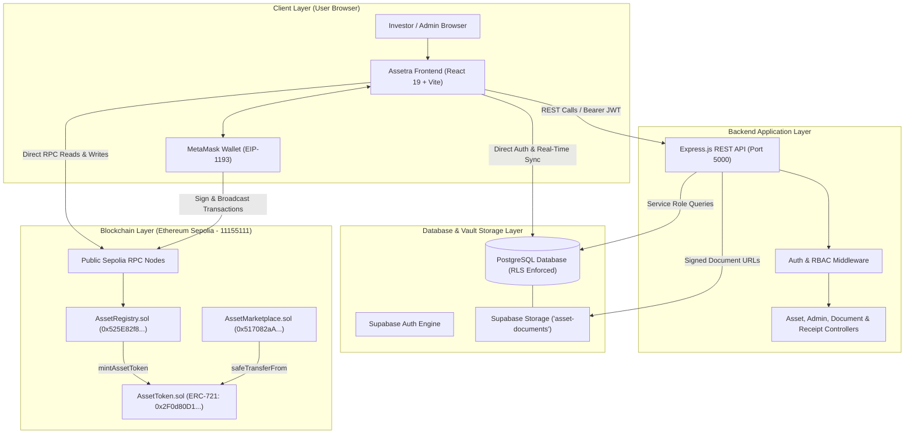
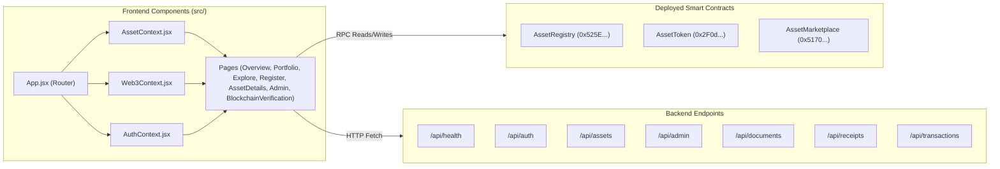
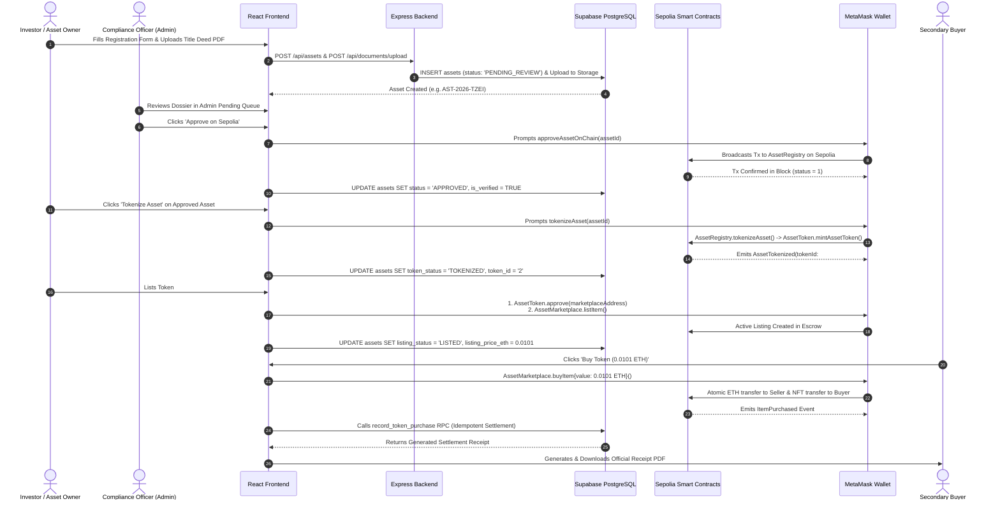
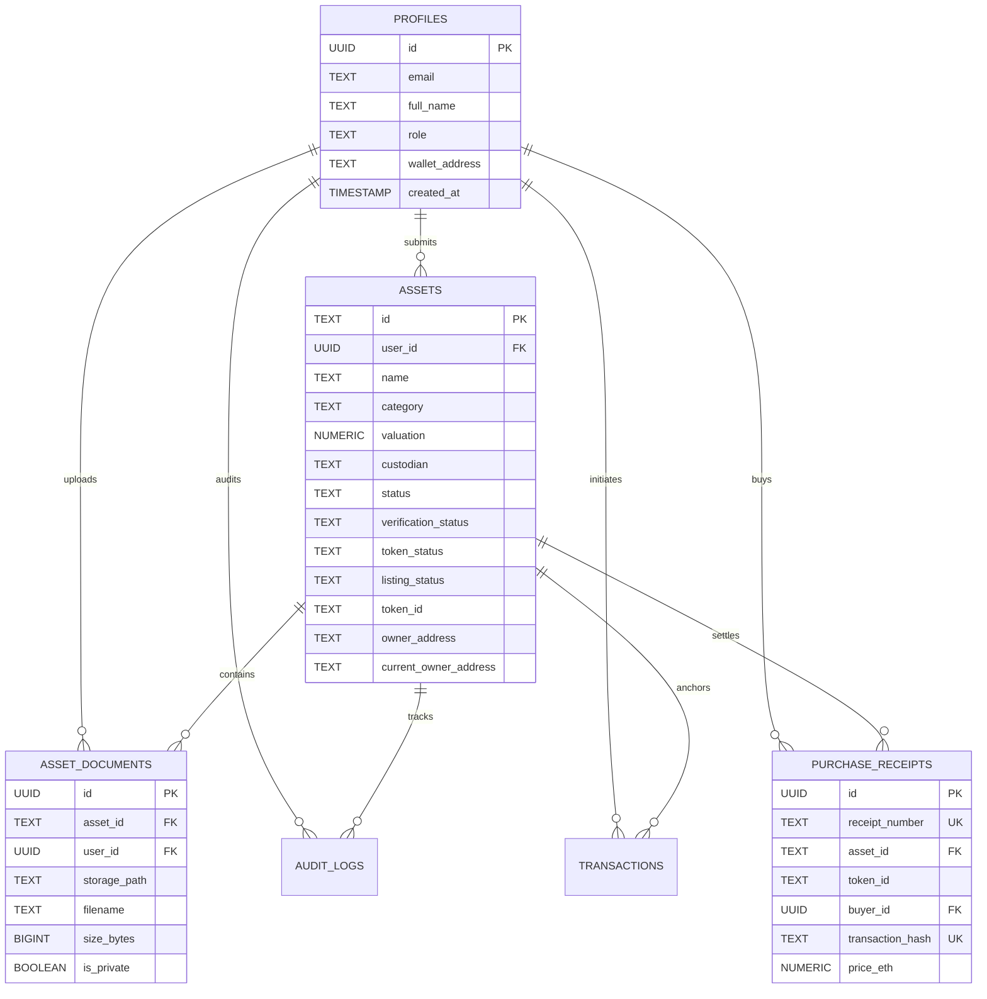

# ASSETRA: TOKENIZED ASSET MANAGEMENT SYSTEM
## Comprehensive Technical Documentation, Source-Code Audit & Architectural Reference Manual

```
========================================================================================
Project Name:       Assetra (Institutional Real-World Asset Tokenization Protocol)
Target Environment: Node.js (v18+/v20+), React 19 / Vite 8, Express.js 4, Solidity 0.8.24
Blockchain Network: Ethereum Sepolia Testnet (Chain ID: 11155111 / 0xaa36a7)
Database & Storage: Supabase PostgreSQL, Supabase Storage Vault (Encrypted Off-Chain)
Contracts Deployed: AssetToken (ERC-721), AssetRegistry, AssetMarketplace
Author / Student:   Assetra Engineering Team (College Demonstration Edition)
Document Revision:  2.4.0 (Authoritative Source-Code Audit)
========================================================================================
```

---

## TABLE OF CONTENTS

1. [Part 1: Project Overview & System Architecture](#part-1-project-overview--system-architecture)
   - 1.1 Executive Summary & Problem Solved
   - 1.2 Real-World Use Case for Real-World Asset (RWA) Tokenization
   - 1.3 Target Users, Actors, and Role-Based Permissions
   - 1.4 Complete Technology Stack & Technical Rationale
   - 1.5 System Architecture & Multi-Tier Topology (Mermaid Diagram)
   - 1.6 Component Architecture Diagram
   - 1.7 End-to-End Data Flow Diagram
   - 1.8 Architectural Separation: Blockchain vs. Database vs. Storage
   - 1.9 Project Repository Directory Structure
   - 1.10 Application Startup, Inter-Service Communication & Environment Variables
2. [Part 2: Complete Website Page & Master Button Inventory](#part-2-complete-website-page--master-button-inventory)
   - 2.1 Route Map & Access Hierarchy
   - 2.2 Exhaustive Page & Interactive Element Catalog (Master Button Table)
3. [Part 3: Complete User Journeys & Workflow Execution Traces](#part-3-complete-user-journeys--workflow-execution-traces)
   - 3.1 Journey A: New User Registration & First-Time Onboarding
   - 3.2 Journey B: Investor Sign-In & Session Establishment
   - 3.3 Journey C: Administrator Authentication & Role Verification
   - 3.4 Journey D: Real-World Asset Registration & Off-Chain Document Ingestion
   - 3.5 Journey E: Administrative Compliance Review & Inspection Queue
   - 3.6 Journey F: On-Chain Asset Registration (Sepolia AssetRegistry)
   - 3.7 Journey G: On-Chain Asset Approval (Cryptographic Verifier Gate)
   - 3.8 Journey H: Asset Tokenization & ERC-721 NFT Minting
   - 3.9 Journey I: Cross-User Marketplace Discovery & Portfolio Tracking
   - 3.10 Journey J: Trustless Marketplace Listing & Approval Escalation
   - 3.11 Journey K: Atomic Marketplace Purchase via ETH Transfer
   - 3.12 Journey L: Marketplace Delisting & Dynamic Price Updating
   - 3.13 Journey M: Settlement Receipt PDF Generation & Cryptographic Idempotency
   - 3.14 Journey N: Real-Time Blockchain Verification & Contract Auditing
   - 3.15 Journey O: MetaMask Wallet Lifecycle & Multi-Chain Handling
   - 3.16 Journey P: Error Recovery, Double-Submission & Idempotency Safeguards
4. [Part 4: Smart Contract Deep Dive & EVM State Machine](#part-4-smart-contract-deep-dive--evm-state-machine)
   - 4.1 AssetRegistry.sol (Protocol Registry & Gatekeeper)
   - 4.2 AssetToken.sol (ERC-721 Tokenization & Metadata URI)
   - 4.3 AssetMarketplace.sol (Trustless Escrow & Atomic Settlement)
   - 4.4 Contract Interconnectivity & Inter-Contract Invocations
   - 4.5 Deployed Sepolia Contract Addresses & Initialization Setup
   - 4.6 Legal Title vs. Cryptographic NFT Ownership
5. [Part 5: Blockchain Transactions & Gas Fee Econometrics](#part-5-blockchain-transactions--gas-fee-econometrics)
   - 5.1 Comprehensive Write-Transaction Matrix
   - 5.2 Gas Fundamentals: Limits, Used, Base Fee & Priority Fee
   - 5.3 Read vs. Write Operations: Why Views Are Gas-Free
   - 5.4 Reverted Transactions & Failed Execution Costs
   - 5.5 Payer Analysis: Who Pays Gas in Assetra?
   - 5.6 Gas Pricing Formulas & Hypothetical Numerical Example
   - 5.7 Live Sepolia Etherscan Verification of Real Recorded Transactions
6. [Part 6: ETH Payments & Trustless Marketplace Dynamics](#part-6-eth-payments--trustless-marketplace-dynamics)
   - 6.1 Atomic Settlement & Zero-Counterparty Risk
   - 6.2 Checks-Effects-Interactions & ReentrancyGuard Defense
   - 6.3 Overpayment Refunds & Exact Price Enforcement
   - 6.4 Listing Lifecycle After Purchase
   - 6.5 Sepolia Testnet ETH Nature & Economic Boundaries
7. [Part 7: Database Architecture & Off-Chain Storage](#part-7-database-architecture--off-chain-storage)
   - 7.1 PostgreSQL Database Schema & Relational Structure
   - 7.2 Tables, Data Types, Constraints & Foreign Keys
   - 7.3 Supabase Row Level Security (RLS) Policies
   - 7.4 Stored Procedures, Triggers & Security Definer RPCs
   - 7.5 Supabase Storage Vault vs. IPFS Pointers
8. [Part 8: Backend REST API Reference](#part-8-backend-rest-api-reference)
   - 8.1 API Controller Architecture & Middleware Pipeline
   - 8.2 Exhaustive Endpoint Specification Table
   - 8.3 Security Middleware: JWT Authentication & Role-Based Guarding
   - 8.4 Error Handling & Fallback Architectures
9. [Part 9: Frontend Architecture & Client-Side Web3 Integration](#part-9-frontend-architecture--client-side-web3-integration)
   - 9.1 React 19 Component Topology & Context Architecture
   - 9.2 Web3Context: MetaMask EIP-1193 Provider & Sepolia Detection
   - 9.3 AssetContext: Authoritative State Synchronization
   - 9.4 Client-Side PDF Generation Engine (receiptPdfGenerator.js)
10. [Part 10: Security Audit, Trust Boundaries & Architectural Limitations](#part-10-security-audit-trust-boundaries--architectural-limitations)
    - 10.1 Authentication & Privilege Escalation Defenses
    - 10.2 Public Blockchain Privacy vs. Off-Chain Confidentiality
    - 10.3 Centralized Verifier Trust Assumption
    - 10.4 Verified Facts vs. Unverified Claims vs. Known Limitations
11. [Part 11: Comprehensive Error Dictionary & Troubleshooting](#part-11-comprehensive-error-dictionary--troubleshooting)
    - 11.1 MetaMask & Network Errors
    - 11.2 Smart Contract Revert Codes & Require Messages
    - 11.3 Database & Supabase RLS Exceptions
12. [Part 12: Viva Demonstration Plan & Evaluator Script](#part-12-viva-demonstration-plan--evaluator-script)
    - 12.1 Step-by-Step Live Examination Walkthrough
    - 12.2 Examiner Evidence Checklist (Screenshots, Hashes & RPC Responses)
13. [Part 14: Technical Glossary & Rapid Revision Cheat Sheet](#part-14-technical-glossary--rapid-revision-cheat-sheet)
    - 14.1 Core Technical Glossary (40+ Terms)
    - 14.2 One-Page Architectural Summary
    - 14.3 Two-Minute Pitch for Viva Evaluators

---

# PART 1: PROJECT OVERVIEW & SYSTEM ARCHITECTURE

### 1.1 Executive Summary & Problem Solved
**Assetra** is an enterprise-grade, institutional Real-World Asset (RWA) Tokenization and Management Protocol. In traditional finance, tangible illiquid assets—such as commercial real estate, industrial infrastructure, fine art, and precious commodities—suffer from four structural bottlenecks:
1. **Severe Illiquidity**: Transacting commercial property or industrial assets takes weeks or months of legal paperwork, title searches, and bank clearances.
2. **High Barriers to Capital**: Minimum investment thresholds prevent retail and smaller institutional investors from accessing prime asset yields.
3. **Opaque Ownership Records**: Physical paper deeds and siloed government registries create counterparty risks, deed forgery opportunities, and lengthy title reconciliations.
4. **Settlement Latency & Intermediary Fees**: Brokers, escrow agents, legal custodians, and title insurance firms extract 3% to 8% in transaction friction while adding multi-day settlement delays.

Assetra solves these challenges by bridging **off-chain institutional compliance and legal asset custody** with **on-chain EVM smart contracts**. By anchoring asset appraisal proofs, surveyor deeds, and verified valuations into an immutable registry (`AssetRegistry.sol`), tokenizing beneficial ownership into non-fungible tokens (`AssetToken.sol` ERC-721), and enabling trustless atomic exchange (`AssetMarketplace.sol`), Assetra reduces settlement times from weeks to seconds while maintaining compliance and audit trails.

---

### 1.2 Real-World Use Case for Real-World Asset (RWA) Tokenization
Consider a commercial property in Paris appraised at **$40,000,000 USD** (represented in Assetra as asset `AST-2026-TZEI`):
1. **Physical Ingestion**: The beneficial owner submits the property title, location coordinates, appraisal date, custodian firm ("ya firm"), and legal deeds into Assetra.
2. **Encrypted Storage**: The document files are uploaded to an encrypted, access-controlled vault in Supabase Storage (`asset-documents` bucket).
3. **Compliance Review & Verification**: An authorized compliance administrator examines the deeds, checks the appraisal, and executes an on-chain verification transaction (`approveAssetOnChain`) using an authorized verifier wallet.
4. **NFT Minting**: Once approved, the asset is tokenized into a unique ERC-721 non-fungible token (Token ID #2) on the Ethereum Sepolia blockchain.
5. **Secondary Marketplace Trading**: The owner lists Token #2 on `AssetMarketplace.sol` for **0.0101 ETH**.
6. **Atomic Settlement**: A buyer purchases the asset. In a single EVM transaction, the buyer's ETH is transferred to the seller, and the NFT title is atomically transferred to the buyer's wallet, with reentrancy protection and instant settlement receipt generation.

---

### 1.3 Target Users, Actors, and Role-Based Permissions

Assetra enforces strict Role-Based Access Control (RBAC) across both database tables and smart contracts:

| User Role / Actor | Description | System Privileges | Verification Method |
| :--- | :--- | :--- | :--- |
| **Investor / Asset Owner** (`USER`) | Beneficial owners and institutional investors. | • Register new assets for review<br>• Upload legal deeds to storage<br>• View personal portfolio and deeds<br>• Tokenize approved assets<br>• List, delist, and purchase on marketplace<br>• Download PDF settlement receipts | Supabase Auth JWT (`profiles.role = 'USER'`), MetaMask wallet address match |
| **Compliance Officer / Administrator** (`ADMIN`) | Authorized protocol auditors and KYC/AML verifiers. | • Full access to admin control center<br>• Inspect review queues & audit logs<br>• Start reviews, request info, approve, or reject assets<br>• Execute on-chain approval transactions (`onlyVerifier`)<br>• Execute protocol-level tokenization mints | Supabase Auth JWT (`profiles.role = 'ADMIN'`), Solidity `onlyVerifier` modifier |
| **Smart Contract Owner** (`deployer`) | Deployer address (`0x726541B8...`). | • Update designated verifier address (`setVerifierAddress`)<br>• Authorize registry address on token contract (`setRegistryContract`)<br>• Emergency admin overrides | Solidity `Ownable(msg.sender)` checks |

---

### 1.4 Complete Technology Stack & Technical Rationale

```
┌────────────────────────────────────────────────────────────────────────┐
│                              FRONTEND                                  │
│  React 19.0.0          • Component-based reactive UI rendering         │
│  Vite 8.0.0            • Lightning-fast ESM dev server & asset bundler │
│  ethers.js 6.17.0      • Ethereum JSON-RPC provider & contract client  │
│  React Router DOM 7.0  • Declarative client-side routing & auth guards │
│  Lucide React 1.16.0   • Clean, modern fintech iconography             │
│  Vanilla CSS Variables • Custom luxury financial design system (#20211F)│
└────────────────────────────────────────────────────────────────────────┘
                                    │
                                    ▼
┌────────────────────────────────────────────────────────────────────────┐
│                              BACKEND                                   │
│  Node.js (v18+/v20+)   • Non-blocking asynchronous JavaScript runtime  │
│  Express.js 4.21.2     • RESTful API routing and security middleware   │
│  @supabase/supabase-js • Official Supabase client for DB & Auth        │
│  jsonwebtoken 9.0.2    • Cryptographic JWT signing & verification      │
│  multer 1.4.5          • Multipart/form-data upload stream processing  │
│  express-rate-limit    • Brute-force protection on auth endpoints      │
└────────────────────────────────────────────────────────────────────────┘
                                    │
                                    ▼
┌────────────────────────────────────────────────────────────────────────┐
│                       DATABASE & STORAGE LAYER                         │
│  Supabase PostgreSQL   • Relational database with Row Level Security   │
│  Supabase Auth (GoTrue)• PKCE password authentication & session tokens │
│  Supabase Storage      • S3-compatible encrypted object storage        │
│  PL/pgSQL Functions    • Idempotent, atomic transactional purchase RPC │
└────────────────────────────────────────────────────────────────────────┘
                                    │
                                    ▼
┌────────────────────────────────────────────────────────────────────────┐
│                      BLOCKCHAIN & SMART CONTRACTS                      │
│  Solidity 0.8.24       • Type-safe smart contract programming language │
│  OpenZeppelin v5.0.2   • Battle-tested ERC-721, Ownable, Reentrancy    │
│  Hardhat 2.22.2        • EVM development, testing & deployment harness │
│  Ethereum Sepolia      • Public PoS testnet (Chain ID: 11155111)       │
│  Sepolia Etherscan     • Public ledger transparency & block explorer   │
└────────────────────────────────────────────────────────────────────────┘
```

---

### 1.5 System Architecture & Multi-Tier Topology



---

### 1.6 Component Architecture Diagram



---

### 1.7 End-to-End Data Flow Diagram



---

### 1.8 Architectural Separation: Blockchain vs. Database vs. Storage

A core question in technical examinations is: **"Why doesn't Assetra store everything on the blockchain?"**
Assetra maintains a strict three-tier data separation policy:

| Data Type | Primary Storage Layer | Why It Is Placed There | Cost & Performance Impact |
| :--- | :--- | :--- | :--- |
| **Token Ownership & Minting Roots** | Ethereum Sepolia Blockchain (`AssetToken.sol`) | Decentralized, immutable, censorship-resistant proof of ownership that cannot be altered even by database administrators. | Consumes gas (approx. 80,000–160,000 gas per mint/transfer). |
| **Protocol State & Verifier Approvals** | Ethereum Sepolia Blockchain (`AssetRegistry.sol`) | Smart contract execution gate ensures unapproved assets can never be tokenized or traded on-chain. | Read calls (`view`) are free; write calls require transaction gas. |
| **Marketplace Escrow & Settlement** | Ethereum Sepolia Blockchain (`AssetMarketplace.sol`) | Eliminates escrow counterparty risk; atomic ETH payment guarantees seller is paid simultaneously with token transfer. | Standard transaction gas paid by buyer. |
| **Relational Metadata & User Profiles** | Supabase PostgreSQL | Fast indexing, full-text searching, category filtering, password hashing, and user preferences. | Sub-10ms response time; zero gas cost. |
| **Large Documents & Title Deeds** | Supabase Storage (`asset-documents` bucket) | A 5 MB PDF title deed would cost **hundreds of dollars in Ethereum gas** if stored on-chain. Large binaries belong in encrypted object storage. | Zero blockchain gas; secured by pre-signed short-lived URLs. |
| **Audit Logs & Historical Notes** | Supabase `audit_logs` table | Comprehensive administrative history and review comments for regulatory compliance. | High write throughput; accessible only to administrators. |

> [!IMPORTANT]
> **Key Viva Distinction**: An `ipfsHash` or URI stored on the smart contract is simply an alphanumeric pointer string (e.g. `https://assetra.io/api/metadata/AST-2026-TZEI`). It **does not mean** the underlying multi-megabyte PDF deed is stored inside Ethereum's storage slots.

---

### 1.9 Project Repository Directory Structure

```
c:\Assetra\
├── docs/                                 # Architectural specifications & viva guides
│   ├── api.md                           # REST API endpoint reference
│   ├── architecture.md                  # High-level architecture documentation
│   ├── audit_report.md                  # Project status & automated test report
│   ├── deployment.md                    # Environment setup & run guide
│   ├── ASSETra_COMPLETE_PROJECT_DOCUMENTATION.md # This authoritative manual
│   └── ASSETra_VIVA_QUESTIONS_AND_ANSWERS.md    # 80+ Technical Viva Q&A Guide
├── backend/                             # Express.js REST API & Indexer Service
│   ├── src/
│   │   ├── app.js                       # Express application & middleware assembly
│   │   ├── server.js                    # Server entrypoint (Port 5000)
│   │   ├── config/                      # Database & Supabase connection configs
│   │   ├── controllers/                 # Route controllers (asset, admin, document, etc.)
│   │   ├── middleware/                  # JWT auth, RBAC, multer file upload, error handler
│   │   ├── models/                      # PostgreSQL fallback schema
│   │   ├── routes/                      # Express route definitions
│   │   └── services/                    # Business logic (assetService, authService, indexer)
│   ├── package.json                     # Backend dependencies & test scripts
│   └── .env                             # Environment configuration (redacted)
├── frontend/                            # React 19 + Vite Web Application
│   ├── index.html                       # HTML5 entrypoint with Google Fonts
│   ├── vite.config.js                   # Vite bundler configuration
│   ├── package.json                     # Frontend dependencies
│   ├── .env.local                       # Client-side environment variables
│   └── src/
│       ├── App.jsx                      # Route definitions & layout wrappers
│       ├── main.jsx                     # React root mount
│       ├── components/                  # UI components (auth, layout, common, blockchain)
│       ├── constants/                   # Contract ABIs, deployed addresses, network configs
│       ├── context/                     # Shared React state (AuthContext, Web3Context, AssetContext)
│       ├── pages/                       # Application pages (Investor & Admin portals)
│       ├── styles/                      # Luxury finance design system (theme.css)
│       └── utils/                       # Vector PDF receipt generator (receiptPdfGenerator.js)
├── smart-contracts/                     # Solidity Hardhat Environment
│   ├── contracts/                       # Solidity contracts (Registry, Token, Marketplace)
│   ├── scripts/                         # Deployment scripts (deploy.js)
│   ├── test/                            # Hardhat Chai/Mocha unit test suite
│   ├── deployment-sepolia.json          # Deployment records & contract addresses
│   ├── hardhat.config.js                # Hardhat network & compiler configuration
│   └── package.json                     # Smart contract dependencies
└── supabase/                            # Supabase Migrations & Provisioning
    ├── migrations/                      # Version-controlled SQL migration scripts
    └── provision_admin.sql              # Administrator provisioning & password reset script
```

---

### 1.10 Application Startup, Inter-Service Communication & Environment Variables

#### How the Application Boots:
1. **Smart Contracts**: Compiled via `npx hardhat compile` (solc 0.8.24). Deployed to Sepolia using `scripts/deploy.js`. Deployed addresses are exported to `deployment-sepolia.json` and mirrored into `frontend/src/constants/contracts.js`.
2. **Backend**: Runs on `http://localhost:5000`. Starts via `node src/server.js`. Connects to Supabase PostgreSQL; if unavailable, falls back gracefully to in-memory event buffers.
3. **Frontend**: Runs on `http://localhost:5173`. Starts via `vite`. Initializes `AuthProvider`, `Web3Provider`, and `AssetProvider`. `Web3Provider` passively detects MetaMask and network chain ID, while `AssetProvider` fetches live assets from Supabase.

#### Required Environment Variables (All Secrets Redacted):

##### Backend (`backend/.env`):
```ini
# Database & Cloud Storage
SUPABASE_URL=https://[PROJECT-ID].supabase.co
SUPABASE_PUBLISHABLE_KEY=[REDACTED-PUBLIC-ANON-KEY]
SUPABASE_SECRET_KEY=[REDACTED-SERVICE-ROLE-KEY]

# Server Runtime
PORT=5000
NODE_ENV=development
JWT_SECRET=[REDACTED-JWT-SIGNING-SECRET]

# Blockchain Configuration (Ethereum Sepolia)
RPC_URL=https://ethereum-sepolia-rpc.publicnode.com
REGISTRY_CONTRACT_ADDRESS=0x525E82f822E004838004ffd6Fe1366Be244EC671
TOKEN_CONTRACT_ADDRESS=0x2F0d80D15773A473A00bE3B732D4B46974732501
MARKETPLACE_CONTRACT_ADDRESS=0x517082aA429ED926BDbeC904a1879BaE1aFd05f7
```

##### Frontend (`frontend/.env.local`):
```ini
# Supabase Client Access
VITE_SUPABASE_URL=https://[PROJECT-ID].supabase.co
VITE_SUPABASE_PUBLISHABLE_KEY=[REDACTED-PUBLIC-ANON-KEY]

# Blockchain Deployed Contract Addresses (Sepolia Testnet: 11155111)
VITE_CHAIN_ID=11155111
VITE_REGISTRY_CONTRACT_ADDRESS=0x525E82f822E004838004ffd6Fe1366Be244EC671
VITE_TOKEN_CONTRACT_ADDRESS=0x2F0d80D15773A473A00bE3B732D4B46974732501
VITE_MARKETPLACE_CONTRACT_ADDRESS=0x517082aA429ED926BDbeC904a1879BaE1aFd05f7
```

---

# PART 2: COMPLETE WEBSITE PAGE & MASTER BUTTON INVENTORY

### 2.1 Route Map & Access Hierarchy

```
PUBLIC / GUEST ROUTES (Wrapped in <GuestRoute>)
├── /login                            -> LoginSelection.jsx (Portal gateway selection)
├── /user/login                       -> UserLogin.jsx (Investor login)
├── /user/register, /register-user    -> UserRegister.jsx (Investor registration)
└── /admin/login                      -> AdminLogin.jsx (Administrator login)

AUTHENTICATED INVESTOR PORTAL (Wrapped in <ProtectedRoute> + <UserLayout>)
├── /user/dashboard                   -> Overview.jsx (Portfolio metrics & activity)
├── /portfolio                        -> Portfolio.jsx (User-owned assets & certificates)
├── /explore                          -> ExploreAssets.jsx (Marketplace directory)
├── /register                         -> RegisterAsset.jsx (RWA registration & upload)
├── /verification-status              -> VerificationStatus.jsx (Application tracking)
├── /asset/:id                        -> AssetDetails.jsx (Asset detail & trading)
├── /blockchain-verification, /verify -> BlockchainVerification.jsx (On-chain state audit)
├── /transactions                     -> Transactions.jsx (Audited financial ledger)
└── /settings                         -> Settings.jsx (Account & wallet settings)

AUTHENTICATED COMPLIANCE PORTAL (Wrapped in <ProtectedRoute requiredRole="ADMIN"> + <AdminLayout>)
├── /admin, /admin/dashboard          -> AdminOverview.jsx (Control center metrics)
├── /admin/pending                    -> AdminPendingReviews.jsx (Compliance queue)
├── /admin/approved                   -> AdminApprovedAssets.jsx (Approved registry)
├── /admin/rejected                   -> AdminRejectedAssets.jsx (Rejected submissions)
├── /admin/blockchain                 -> AdminBlockchain.jsx (Minting & operations)
├── /admin/blockchain-verification    -> BlockchainVerification.jsx (Admin audit)
├── /admin/audit-logs                 -> AdminAuditLogs.jsx (Immutable compliance logs)
└── /admin/settings                   -> AdminSettings.jsx (Protocol settings)
```

---

### 2.2 Exhaustive Page & Interactive Element Catalog (Master Button Table)

Below is the verified master inventory of every interactive element discovered across the application:

| Page & Route | UI Element Label | Component & File | Handler / Callback | Target Action & Protocol Layer | Gas / Wallet? | Success & Failure State | Status |
| :--- | :--- | :--- | :--- | :--- | :--- | :--- | :--- |
| **LoginSelection**<br>`/login` | "Access Investor Portal" | `LoginSelection.jsx` | `Link to="/user/login"` | Frontend routing | No wallet / No gas | Transitions to Investor Sign-In. | Implemented |
| **LoginSelection**<br>`/login` | "Authorized Verifier Sign In" | `LoginSelection.jsx` | `Link to="/admin/login"` | Frontend routing | No wallet / No gas | Transitions to Admin Sign-In. | Implemented |
| **UserLogin**<br>`/user/login` | "Sign In as Investor" | `UserLogin.jsx` | `handleSubmit(e)` | `login(email, password)` via Supabase Auth | No wallet / No gas | Success: Sets session, redirects to `/user/dashboard`.<br>Failure: Displays error banner. | Implemented |
| **UserLogin**<br>`/user/login` | Password toggle icon | `UserLogin.jsx` | `setShowPassword(!showPassword)` | Frontend state toggle | No wallet / No gas | Toggles input type between `password` and `text`. | Implemented |
| **UserRegister**<br>`/user/register` | "Auto-detect Connected Wallet" | `UserRegister.jsx` | `setWalletAddress(account)` | Reads active MetaMask address from `Web3Context` | Reads wallet / No gas | Populates wallet input with connected 0x address. | Implemented |
| **UserRegister**<br>`/user/register` | "Create Investor Account" | `UserRegister.jsx` | `handleSubmit(e)` | `register(email, password, ...)` -> Supabase Auth & `profiles` table | No wallet / No gas | Success: User profile created with `role='USER'`. Redirects to `/user/dashboard`. | Implemented |
| **AdminLogin**<br>`/admin/login` | "Sign In as Administrator" | `AdminLogin.jsx` | `handleSubmit(e)` | `login(email, password)` + verifies `role === 'ADMIN'` | No wallet / No gas | Success: Opens `/admin/dashboard`.<br>Failure: Rejects non-admin users with access denied. | Implemented |
| **Topbar (User/Admin)** | "Connect MetaMask" / Account pill | `UserTopbar.jsx` | `handleWalletClick()` | `connectWallet()` -> triggers `eth_requestAccounts` | MetaMask prompt / No gas | Success: Connects wallet, updates balance.<br>Failure: Shows connection error toast. | Implemented |
| **Topbar (User/Admin)** | "Switch to Sepolia" | `UserTopbar.jsx` | `switchToSepolia()` | `wallet_switchEthereumChain` (`0xaa36a7`) | MetaMask prompt / No gas | Switches network; adds Sepolia automatically if missing. | Implemented |
| **Topbar (User/Admin)** | "Disconnect" | `UserTopbar.jsx` | `disconnectWallet()` | Resets Web3Context state | No gas | Clears account and resets balance to 0.00. | Implemented |
| **RegisterAsset**<br>`/register` | "Use Connected Wallet" | `RegisterAsset.jsx` | `setOwnerAddress(account)` | Reads address from `Web3Context` | No gas | Fills owner address with connected wallet. | Implemented |
| **RegisterAsset**<br>`/register` | Document File Dropzone | `RegisterAsset.jsx` | `handleFileDrop(e)` | Validates file type (PDF/PNG) and size (<10MB) | No gas | Queues file in local upload list. | Implemented |
| **RegisterAsset**<br>`/register` | "Submit for Compliance Review" | `RegisterAsset.jsx` | `handleSubmit(e)` | Calls `registerAsset()` + `uploadAssetDocument()` to Supabase Storage | No wallet / No gas | Success: DB record created (`PENDING_REVIEW`). Redirects to `/verification-status`. | Implemented |
| **AdminPending**<br>`/admin/pending` | "Start Review" | `AdminPendingReviews.jsx` | `handleStartReview(asset)` | `updateAssetStatus(id, 'UNDER_REVIEW')` -> DB & Audit log | No wallet / No gas | Asset status changes to `UNDER_REVIEW`. Reviewer assigned. | Implemented |
| **AdminPending**<br>`/admin/pending` | "Inspect Dossier" | `AdminPendingReviews.jsx` | `setActiveAsset(asset)` | Opens modal; fetches documents from `asset_documents` | No gas | Displays legal deeds, checklist, and audit controls. | Implemented |
| **AdminPending**<br>`/admin/pending` | "Download Title Deed" | `AdminPendingReviews.jsx` | `getDocumentDownloadUrl(path)` | Calls Supabase Storage `createSignedUrl(300)` | No gas | Opens secure, short-lived 5-minute pre-signed URL. | Implemented |
| **AdminPending**<br>`/admin/pending` | "Approve on Sepolia" | `AdminPendingReviews.jsx` | `handleApprove(asset)` | **On-Chain**: 1. `registerAsset` (if unanchored)<br>2. `approveAssetOnChain(id)` | **MetaMask prompt**<br>**Consumes gas** (paid by Admin) | Success: Confirmed on Sepolia block; DB updated to `APPROVED`.<br>Failure: Reverts if caller not verifier. | Implemented |
| **AdminPending**<br>`/admin/pending` | "Reject Submission" | `AdminPendingReviews.jsx` | `handleRejectSubmit()` | `updateAssetStatus(id, 'REJECTED')` with reason | No gas | Marks submission REJECTED in database & audit log. | Implemented |
| **AdminPending**<br>`/admin/pending` | "Request More Info" | `AdminPendingReviews.jsx` | `handleRequestInfoSubmit()` | `updateAssetStatus(id, 'MORE_INFO_REQUESTED')` | No gas | Re-opens applicant editing permissions in user portal. | Implemented |
| **VerificationStatus**<br>`/verification-status` | "Resubmit Application" | `VerificationStatus.jsx` | `handleResubmitSubmit(e)` | `updateAssetStatus(id, 'PENDING_REVIEW')` | No gas | Updates valuation/notes and resets status to pending review. | Implemented |
| **AdminBlockchain**<br>`/admin/blockchain` | "Tokenize Asset" (CTA) | `AdminBlockchain.jsx` | `handleOpenMintModal(asset)` | Opens modal to configure symbol and supply | No gas | Displays tokenization parameters modal. | Implemented |
| **AdminBlockchain**<br>`/admin/blockchain` | "Execute On-Chain Tokenization" | `AdminBlockchain.jsx` | `handleExecuteTokenization()` | **On-Chain**: `AssetRegistry.tokenizeAsset(id)` -> calls `AssetToken.mintAssetToken()` | **MetaMask prompt**<br>**Consumes gas** (paid by Admin/Owner) | Success: Mints ERC-721 token; parses `AssetTokenized` event; updates DB to `TOKENIZED`. | Implemented |
| **AssetDetails**<br>`/asset/:id` | "List for Sale" | `AssetDetails.jsx` | `handleExecuteListing(e)` | **On-Chain**: 1. `AssetToken.approve(marketplace)`<br>2. `AssetMarketplace.listItem(token, id, price)` | **MetaMask prompt (x2)**<br>**Consumes gas** (paid by Seller) | Success: Token placed in escrow; listing active on Sepolia; DB updated to `LISTED`. | Implemented |
| **AssetDetails**<br>`/asset/:id` | "Buy Token (X ETH)" | `AssetDetails.jsx` | `handleExecutePurchase()` | **On-Chain**: `AssetMarketplace.buyItem{value: price}(token, id)` | **MetaMask prompt**<br>**Transfers ETH + Gas** (paid by Buyer) | Success: Token transferred to buyer; seller receives ETH; calls `record_token_purchase` RPC; generates PDF receipt. | Implemented |
| **AssetDetails**<br>`/asset/:id` | "Delist from Marketplace" | `AssetDetails.jsx` | `handleExecuteDelist()` | **On-Chain**: `AssetMarketplace.delistItem(token, id)` | **MetaMask prompt**<br>**Consumes gas** (paid by Seller) | Success: Listing deactivated on contract; DB updated to `UNLISTED`. | Implemented |
| **AssetDetails**<br>`/asset/:id` | "Update Price" | `AssetDetails.jsx` | `handleExecutePriceUpdate()` | **On-Chain**: `AssetMarketplace.updatePrice(token, id, newPrice)` | **MetaMask prompt**<br>**Consumes gas** (paid by Seller) | Success: Price updated on contract; DB listing price updated. | Implemented |
| **AssetDetails**<br>`/asset/:id` | "Settlement Receipt (PDF)" | `AssetDetails.jsx` | `setShowReceiptModal(true)` | Opens receipt viewer modal | No gas | Displays formatted vector settlement receipt. | Implemented |
| **AssetDetails**<br>`/asset/:id` | "Download PDF" | `AssetDetails.jsx` | `downloadReceiptPdf(receipt)` | `receiptPdfGenerator.js` builds PDF-1.4 binary | No gas | Triggers immediate client-side download of `.pdf` file. | Implemented |
| **AssetDetails**<br>`/asset/:id` | "Verify on Blockchain" | `AssetDetails.jsx` | `navigate('/blockchain-verification?id=' + id)` | Frontend navigation to verification page | No gas | Pre-loads asset into live Sepolia verification auditor. | Implemented |
| **BlockchainVerification**<br>`/blockchain-verification` | "Verify On-Chain" (Search) | `BlockchainVerification.jsx` | `handleSearchSubmit(e)` | Live query: `AssetRegistry.isRegistered` & `getAsset` via Sepolia RPC | No wallet / No gas (Local RPC read) | Reconciles live Sepolia contract state against Supabase DB. | Implemented |
| **BlockchainVerification**<br>`/blockchain-verification` | Quick Demo Chips (Pisa/Eifel/Greenview) | `BlockchainVerification.jsx` | `handleSelectQuickChip(id)` | Sets active asset ID and triggers verification | No gas | Instantly audits selected demonstration asset. | Implemented |
| **BlockchainVerification**<br>`/blockchain-verification` | "Inspect Raw EVM JSON" | `BlockchainVerification.jsx` | `setShowRawJson(!showRawJson)` | Frontend UI toggle | No gas | Renders raw Solidity struct JSON returned from RPC. | Implemented |
| **Transactions**<br>`/transactions` | "View on Sepolia Etherscan" | `Transactions.jsx` | Link to Etherscan URL | External link | No gas | Opens transaction hash on Sepolia block explorer. | Implemented |
| **Transactions**<br>`/transactions` | Copy Hash Icon | `Transactions.jsx` | `navigator.clipboard.writeText(hash)` | Browser Clipboard API | No gas | Copies transaction hash; shows checkmark. | Implemented |
| **Settings**<br>`/settings` | "Save Profile Changes" | `Settings.jsx` | `handleSaveProfile()` | Updates `public.profiles` via Supabase client | No gas | Updates user name & wallet address in DB. | Implemented |

---

# PART 3: COMPLETE USER JOURNEYS & WORKFLOW EXECUTION TRACES

### 3.1 Journey A: New User Registration & First-Time Onboarding
1. **User Action**: The applicant visits `/user/register`, inputs their full name, corporate email, password, and optionally clicks **"Auto-detect Connected Wallet"**.
2. **Frontend Handler**: `UserRegister.jsx` executes `handleSubmit(e)`. Validates password confirmation and email format.
3. **Auth Client Call**: Calls `AuthContext.register(email, password, fullName, walletAddress)`, which invokes `supabase.auth.signUp()`.
4. **Database Execution**:
   - Supabase Auth creates an identity row in `auth.users`.
   - The PostgreSQL trigger `handle_new_user()` fires automatically, inserting an initial record into `public.profiles` with `role = 'USER'` (enforced by the trigger; users can never self-assign the `ADMIN` role).
5. **UI State**: The applicant is authenticated, their session JWT is stored in memory, and the router transitions to `/user/dashboard`.

---

### 3.2 Journey B: Investor Sign-In & Session Establishment
1. **User Action**: The investor navigates to `/user/login` and submits their credentials.
2. **Frontend Handler**: `UserLogin.jsx` executes `handleSubmit(e)` -> calls `AuthContext.login(email, password)`.
3. **Database Execution**:
   - `supabase.auth.signInWithPassword()` verifies the password hash against `auth.users`.
   - On success, `AuthContext.fetchUserProfile()` queries `public.profiles` for `role`, `full_name`, and `wallet_address`.
4. **UI State**: `AuthContext` stores the user profile and session token. The user is redirected to `/user/dashboard`.

---

### 3.3 Journey C: Administrator Authentication & Role Verification
1. **User Action**: An administrator visits `/admin/login` and submits their credentials (`admin@assetra.io`).
2. **Frontend Handler**: `AdminLogin.jsx` calls `login(email, password)`.
3. **Strict RBAC Enforcement**:
   - After Supabase Auth authenticates the password, `AdminLogin.jsx` verifies `authenticatedUser.role === 'ADMIN'`.
   - If a normal `USER` tries logging in through `/admin/login`, `AdminLogin.jsx` immediately purges the session via `logout()` and throws: *"Access denied. Authorized administrators and compliance officers only."*
4. **UI State**: Upon admin role confirmation, the user is redirected to `/admin/dashboard`.

---

### 3.4 Journey D: Real-World Asset Registration & Off-Chain Document Ingestion
1. **User Action**: An asset owner fills out the submission form on `/register` (Name, Category, Valuation, Custodian, Location, Description) and drags a title deed PDF into the dropzone.
2. **Frontend Handler**: `RegisterAsset.jsx` validates that valuation > 0 and files are attached, then calls `registerAsset()` from `AssetContext.jsx`.
3. **ID Generation**: A unique identifier is generated (e.g. `AST-2026-` + random 4-character suffix).
4. **Database Insertion**:
   - Inserts row into `public.assets` with `status = 'PENDING_REVIEW'`, `verification_status = 'PENDING'`, `token_status = 'NOT_TOKENIZED'`, and `listing_status = 'UNLISTED'`.
5. **Storage Upload**:
   - `uploadAssetDocument()` validates the MIME type (`application/pdf`) and size (<10MB).
   - Generates a scoped path: `<user_id>/<asset_id>/<timestamp>-filename.pdf`.
   - Uploads binary to Supabase Storage bucket `asset-documents`.
   - Inserts file metadata into `public.asset_documents`.
6. **UI State**: Success alert displays. User is redirected to `/verification-status` to monitor the review queue.

---

### 3.5 Journey E: Administrative Compliance Review & Inspection Queue
1. **Admin Action**: An auditor opens `/admin/pending` and clicks **"Start Review"** on an incoming asset.
2. **Status Transition**: `AdminPendingReviews.jsx` calls `updateAssetStatus(id, 'UNDER_REVIEW')`.
   - Updates `public.assets.status = 'UNDER_REVIEW'`.
   - Inserts audit log into `public.audit_logs` (`action = 'UNDER_REVIEW'`, `admin_email = req.user.email`).
3. **Document Inspection**: The auditor clicks **"Inspect Dossier"**. The app queries `asset_documents` and generates signed short-lived download links (300 seconds expiration) via `supabase.storage.from('asset-documents').createSignedUrl()`.
4. **Compliance Checklist**: The auditor checks physical valuation, survey deed authenticity, custodian status, and clear title.

---

### 3.6 Journey F: On-Chain Asset Registration (Sepolia AssetRegistry)
1. **Admin Action**: In `AdminPendingReviews.jsx`, the auditor clicks **"Approve on Sepolia"**.
2. **Pre-Flight Registration Check**:
   - The frontend queries `AssetRegistry.isRegistered(asset.id)` via the Sepolia RPC provider.
   - If `isRegistered` returns `false`, the frontend initiates registration first.
3. **MetaMask Prompt**: Prompts verifier to sign `AssetRegistry.registerAsset(...)` with:
   - `assetId`: "AST-2026-TZEI"
   - `name`: "pisa tower"
   - `category`: "Real Estate"
   - `location`: "paris"
   - `valuationUSD`: 40000000
   - `custodian`: "ya firm"
   - `ipfsHash`: "https://assetra.io/api/metadata/AST-2026-TZEI"
4. **EVM Execution**: The contract checks `!_registeredIds[assetId]`, initializes `AssetRecord`, pushes `assetId` to `_assetIds`, and emits `AssetRegistered`.
5. **Confirmation**: Transaction is mined into a Sepolia block.

---

### 3.7 Journey G: On-Chain Asset Approval (Cryptographic Verifier Gate)
1. **Verifier Gate Check**: The frontend verifies `signerAddress == registryContract.owner() || signerAddress == registryContract.verifierAddress()`.
2. **MetaMask Prompt**: Signs `AssetRegistry.approveAssetOnChain(assetId)`.
3. **Solidity Execution**:
   - `require(_registeredIds[assetId], "Asset ID does not exist")`
   - `require(!asset.isApproved, "Asset already approved")`
   - Sets `asset.isApproved = true`, `asset.approvedBy = msg.sender`, `asset.approvedAt = block.timestamp`, `asset.status = Status.Approved`.
   - Emits `AssetApproved(assetId, msg.sender, block.timestamp)`.
4. **Database Sync**: On 1 block confirmation, the frontend calls `updateAssetStatus(id, 'APPROVED')` with `verifierAddress`, `txHash`, and `blockNumber`.
5. **UI Update**: Badge updates to green **"Approved"**; asset becomes eligible for tokenization.

---

### 3.8 Journey H: Asset Tokenization & ERC-721 NFT Minting
1. **User Action**: The owner or admin opens `/admin/blockchain` or `/portfolio` and clicks **"Tokenize Asset"**.
2. **Parameter Selection**: Sets token standard (`ERC-721`) and symbol (e.g. `REA-ZEI`).
3. **Contract Call**: `AssetRegistry.tokenizeAsset(assetId)` is called via MetaMask.
4. **Inter-Contract Execution**:
   - `AssetRegistry` verifies `msg.sender == asset.ownerAddress || msg.sender == owner()`.
   - Verifies `asset.isApproved == true` and `asset.status == Status.Approved`.
   - Calls `tokenContract.mintAssetToken(asset.ownerAddress, tokenMetadataURI)`.
   - `AssetToken.sol` verifies `msg.sender == registryContract`, increments `_nextTokenId` (e.g. to #2), calls `_safeMint(owner, tokenId)`, and sets `tokenURI`.
   - `AssetRegistry` updates its internal state: `asset.status = Status.Tokenized`, `asset.tokenId = 2`, and emits `AssetTokenized`.
5. **Database Sync**: The frontend parses the `AssetTokenized` event, extracts Token ID #2, and updates `public.assets`: `token_status = 'TOKENIZED'`, `token_id = '2'`, `contract_address = 0x2F0d...`.

---

### 3.9 Journey I: Cross-User Marketplace Discovery & Portfolio Tracking
1. **Discovery Rules**: The `/explore` page queries `public.assets`. By protocol rule, only assets with `verification_status = 'APPROVED'` or `is_verified = TRUE` are visible to other users. Unapproved drafts remain private to their creators.
2. **Privacy Sanitization**: The owner's wallet address is sanitized for privacy (e.g. `0x7265...9C4B`).
3. **State Reflection**: If an asset is listed on `AssetMarketplace.sol`, the card displays the active listing price in ETH and a **"Buy Token"** CTA.

---

### 3.10 Journey J: Trustless Marketplace Listing & Approval Escalation
1. **Seller Action**: On `/asset/:id`, the asset owner clicks **"List for Sale"** and enters `0.0101 ETH`.
2. **Step 1 — ERC-721 Approval**:
   - The frontend checks `tokenContract.isApprovedForAll()` and `tokenContract.getApproved(tokenId)`.
   - If the marketplace contract (`0x5170...`) is not yet approved, MetaMask prompts `AssetToken.approve(marketplaceAddress, tokenId)`.
   - Once mined, the marketplace is authorized to transfer the NFT upon purchase.
3. **Step 2 — Marketplace Listing**:
   - MetaMask prompts `AssetMarketplace.listItem(tokenAddress, tokenId, priceWei, assetId)`.
   - Contract records `Listing` struct in `_listings[listingId]` with `isActive = true`.
   - Emits `ItemListed`.
4. **Database Sync**: `listTokenForSale()` updates `public.assets`: `listing_status = 'LISTED'`, `listing_price_eth = 0.0101`.

---

### 3.11 Journey K: Atomic Marketplace Purchase via ETH Transfer
1. **Buyer Action**: An investor visits `/asset/:id` and clicks **"Buy Token (0.0101 ETH)"**.
2. **Pre-Purchase Check**: The contract verifies `listing.isActive == true`, `listing.seller == token.ownerOf(tokenId)`, and `msg.sender != listing.seller`.
3. **MetaMask Execution**: Signs `AssetMarketplace.buyItem{value: 10100000000000000 wei}(tokenContract, tokenId)`.
4. **EVM Execution (Atomic)**:
   - Sets `listing.isActive = false` immediately (preventing reentrancy).
   - Transfers 0.0101 ETH directly to the seller: `payable(seller).call{value: price}("")`.
   - Refunds any excess ETH sent by buyer.
   - Transfers NFT from seller to buyer: `token.safeTransferFrom(seller, msg.sender, tokenId)`.
   - Emits `ItemPurchased`.
5. **Database Settlement**:
   - `recordPurchase()` calls PostgreSQL RPC `record_token_purchase`.
   - RPC updates `current_owner_address = buyerWallet`, `listing_status = 'UNLISTED'`.
   - Inserts record into `purchase_receipts` with unique `transaction_hash`.
   - Inserts record into `transactions`.
6. **PDF Generation**: The frontend generates an official PDF settlement receipt with the transaction hash and block number.

---

### 3.12 Journey L: Marketplace Delisting & Dynamic Price Updating
- **Delisting**: The seller calls `AssetMarketplace.delistItem(tokenContract, tokenId)`. Contract sets `listing.isActive = false` and emits `ItemDelisted`. Supabase updates `listing_status = 'UNLISTED'`.
- **Price Update**: The seller calls `AssetMarketplace.updatePrice(tokenContract, tokenId, newPriceWei)`. Contract updates `listing.price` and emits `PriceUpdated`. Supabase updates `listing_price_eth`.

---

### 3.13 Journey M: Settlement Receipt PDF Generation & Cryptographic Idempotency
- When an asset purchase completes, `generateReceiptNumber(txHash)` derives a deterministic receipt number (e.g. `REC-2026-386137`).
- `receiptPdfGenerator.js` creates a clean, vector PDF document following the PDF-1.4 standard directly in memory.
- **Idempotency Guarantee**: `transaction_hash` has a `UNIQUE` index in both `purchase_receipts` and `transactions`. If a network glitch re-transmits the purchase confirmation, the database prevents duplicate records.

---

### 3.14 Journey N: Real-Time Blockchain Verification & Contract Auditing
1. **User Action**: The auditor visits `/blockchain-verification?id=AST-2026-TZEI`.
2. **Direct RPC Query**: Bypassing the database, the frontend reads directly from `AssetRegistry.sol` via `getPublicSepoliaProvider()`.
3. **Dual Read**:
   - Reads `AssetRecord` struct from `AssetRegistry`.
   - If `tokenId > 0`, reads `ownerOf(tokenId)` and `tokenURI(tokenId)` from `AssetToken`.
4. **Reconciliation**: Compares each on-chain field with the corresponding Supabase record.
5. **Status Matrix**: Renders green "Verified Match" badges for matching fields, amber badges for mismatches, and lock badges for fields stored exclusively off-chain.

---

### 3.15 Journey O: MetaMask Wallet Lifecycle & Multi-Chain Handling
1. **Passive Detection**: On mount, `Web3Context` queries `eth_accounts` and `eth_chainId` silently without prompting the user.
2. **Active Connect**: User clicks "Connect Wallet" -> prompts `eth_requestAccounts`.
3. **Chain Validation**: If `chainId !== '11155111'`, `Web3Context` initiates `wallet_switchEthereumChain` with hex `0xaa36a7`.
4. **Auto-Add Fallback**: If MetaMask returns error code `4902` (Unrecognized Chain), `Web3Context` calls `wallet_addEthereumChain` with Sepolia RPC and explorer parameters.
5. **Event Listeners**: Subscribes to `accountsChanged` and `chainChanged`. Re-calculates balances and updates UI state dynamically.

---

### 3.16 Journey P: Error Recovery, Double-Submission & Idempotency Safeguards
- **MetaMask Rejection**: If the user cancels a signature prompt (code `4001`), the UI catches the error, resets the loading spinner, and displays: *"Transaction signature was cancelled in your wallet."*
- **Reverted Transaction**: If an on-chain condition fails (e.g. caller is not verifier), the transaction reverts, no database update occurs, and the user receives the contract revert reason.
- **Duplicate Registration**: `AssetRegistry.sol` enforces `require(!_registeredIds[assetId], "Asset ID already registered")`, preventing duplicate on-chain registration attempts.

---

# PART 4: SMART CONTRACT DEEP DIVE & EVM STATE MACHINE

Assetra's core blockchain architecture consists of three smart contracts written in Solidity 0.8.24 and compiled with the Cancun EVM target and `viaIR: true`.

```
Deployed Contracts on Ethereum Sepolia (Chain ID: 11155111):
├── AssetToken:        0x2F0d80D15773A473A00bE3B732D4B46974732501
├── AssetRegistry:     0x525E82f822E004838004ffd6Fe1366Be244EC671
└── AssetMarketplace:  0x517082aA429ED926BDbeC904a1879BaE1aFd05f7
```

---

### 4.1 AssetRegistry.sol (Protocol Registry & Gatekeeper)

- **Source File**: `smart-contracts/contracts/AssetRegistry.sol`
- **Inheritance**: OpenZeppelin `Ownable(msg.sender)`
- **Primary Responsibility**: Central on-chain authority for registering physical assets, storing metadata hashes, enforcing verifier sign-offs, and authorizing ERC-721 tokenization.

#### Data Structures & State Variables:
```solidity
enum Status { Submitted, Registered, Approved, Rejected, Tokenized, Decommissioned }

struct AssetRecord {
    string assetId;          // e.g. "AST-2026-TZEI"
    string name;             // e.g. "pisa tower"
    string category;         // e.g. "Real Estate"
    string location;         // Physical custody jurisdiction
    uint256 valuationUSD;    // Appraised valuation in USD integer units
    string custodian;        // Appraiser / Custodian firm
    string ipfsHash;         // Cryptographic metadata proof URI
    address ownerAddress;    // Beneficial owner wallet
    Status status;           // Lifecycle enum state
    bool isApproved;         // Access gate for tokenization
    address approvedBy;      // Verifier address that signed approval
    uint256 approvedAt;      // Block timestamp of approval
    uint256 tokenId;         // Minted ERC-721 token ID (0 if unminted)
    uint256 registeredAt;    // Block timestamp of registration
}

AssetToken public tokenContract;       // Connected ERC-721 token contract
address public verifierAddress;        // Authorized compliance verifier wallet
mapping(string => AssetRecord) private _assets;
mapping(string => bool) private _registeredIds;
string[] private _assetIds;
```

#### Modifiers:
- `onlyVerifier()`: Enforces that `msg.sender == owner() || msg.sender == verifierAddress`. Prevents unauthorized accounts from approving or rejecting assets on-chain.

#### Functions:
1. `registerAsset(string assetId, string name, string category, string location, uint256 valuationUSD, string custodian, string ipfsHash) external returns (bool)`
   - Reverts if `assetId` or `name` is empty, `valuationUSD == 0`, or `_registeredIds[assetId] == true`.
   - Initializes `AssetRecord` with `status = Status.Submitted`, `isApproved = false`, and `registeredAt = block.timestamp`.
   - Emits `AssetRegistered`.
2. `approveAssetOnChain(string calldata assetId) external onlyVerifier returns (bool)`
   - Reverts if asset does not exist, is already approved, or is in `Status.Rejected`.
   - Sets `isApproved = true`, `approvedBy = msg.sender`, `approvedAt = block.timestamp`, `status = Status.Approved`.
   - Emits `AssetApproved`.
3. `rejectAssetOnChain(string calldata assetId, string calldata reason) external onlyVerifier returns (bool)`
   - Reverts if asset does not exist or is already approved.
   - Sets `status = Status.Rejected`. Emits `AssetRejected`.
4. `tokenizeAsset(string calldata assetId) external returns (uint256)`
   - Reverts if caller is not owner or contract owner.
   - Reverts if `isApproved == false` or `status != Status.Approved`.
   - Invokes `tokenContract.mintAssetToken(asset.ownerAddress, tokenMetadataURI)`.
   - Sets `status = Status.Tokenized`, `tokenId = mintedTokenId`.
   - Emits `AssetTokenized`.
5. `getAsset(string calldata assetId) external view returns (AssetRecord memory)`: Returns full struct.
6. `isRegistered(string calldata assetId) external view returns (bool)`: Returns existence flag.
7. `getTotalAssets() external view returns (uint256)`: Returns length of `_assetIds`.

---

### 4.2 AssetToken.sol (ERC-721 Tokenization & Metadata URI)

- **Source File**: `smart-contracts/contracts/AssetToken.sol`
- **Inheritance**: OpenZeppelin `ERC721URIStorage`, OpenZeppelin `Ownable`
- **Token Name**: `"Assetra Real World Asset Token"`
- **Token Symbol**: `"ASTRWA"`
- **Primary Responsibility**: Issues unique non-fungible tokens representing verified real-world assets.

#### State Variables:
- `uint256 private _nextTokenId`: Counter initialized to `1`.
- `address public registryContract`: Authorized `AssetRegistry` contract address.

#### Modifiers:
- `onlyAuthorized()`: Enforces `msg.sender == owner() || msg.sender == registryContract`. Prevents arbitrary users from minting tokens directly.

#### Functions:
1. `setRegistryContract(address _registry) external onlyOwner`: Authorizes registry contract address.
2. `mintAssetToken(address to, string calldata metadataURI) external onlyAuthorized returns (uint256)`
   - Reverts if `to == address(0)` or `metadataURI` is empty.
   - Increments `_nextTokenId`, mints token via `_safeMint(to, tokenId)`, sets URI via `_setTokenURI(tokenId, metadataURI)`.
   - Emits `TokenMinted(tokenId, to, metadataURI)`.
   - Returns minted `tokenId`.
3. `getCurrentTokenId() external view returns (uint256)`: Returns the highest minted token ID.

---

### 4.3 AssetMarketplace.sol (Trustless Escrow & Atomic Settlement)

- **Source File**: `smart-contracts/contracts/AssetMarketplace.sol`
- **Inheritance**: OpenZeppelin `ReentrancyGuard`, OpenZeppelin `Ownable`
- **Primary Responsibility**: Trustless secondary market allowing owners to list tokenized assets, update prices, delist, and execute atomic purchases with ETH.

#### Data Structures:
```solidity
struct Listing {
    address seller;
    address tokenContract;
    uint256 tokenId;
    uint256 price;       // Price denominated in wei
    bool isActive;       // Active listing status
    string assetId;      // Off-chain Assetra ID reference
}

mapping(bytes32 => Listing) private _listings;
bytes32[] private _listingKeys;
```

#### Functions:
1. `getListingId(address tokenContract, uint256 tokenId) public pure returns (bytes32)`: Computes `keccak256(abi.encodePacked(tokenContract, tokenId))`.
2. `listItem(address tokenContract, uint256 tokenId, uint256 price, string calldata assetId) external returns (bytes32)`
   - Requires caller is token owner.
   - Requires marketplace contract is approved via `getApproved(tokenId)` or `isApprovedForAll()`.
   - Records listing and emits `ItemListed`.
3. `buyItem(address tokenContract, uint256 tokenId) external payable nonReentrant`
   - Requires `listing.isActive == true`.
   - Requires `msg.value >= listing.price`.
   - Requires `msg.sender != listing.seller`.
   - Sets `listing.isActive = false` (checks-effects-interactions).
   - Forwards ETH payment to seller: `(bool s, ) = payable(seller).call{value: price}("")`.
   - Refunds excess payment: `if (msg.value > price) payable(msg.sender).call{value: excess}("")`.
   - Transfers NFT: `IERC721(tokenContract).safeTransferFrom(seller, msg.sender, tokenId)`.
   - Emits `ItemPurchased`.
4. `delistItem(address tokenContract, uint256 tokenId) external`: Deactivates listing; emits `ItemDelisted`.
5. `updatePrice(address tokenContract, uint256 tokenId, uint256 newPrice) external`: Updates price; emits `PriceUpdated`.
6. `getListing(...) external view returns (Listing memory)`: Returns listing struct.
7. `isAvailableForPurchase(...) external view returns (bool)`: Verifies if item is actively purchasable.

---

### 4.4 Contract Interconnectivity & Inter-Contract Invocations

```mermaid
graph TD
    Deployer["Deployer Account (0x726541B8...)"]
    
    subgraph DeployedContracts["Deployed Sepolia Contracts"]
        Token["AssetToken (0x2F0d80D1...)"]
        Registry["AssetRegistry (0x525E82f8...)"]
        Marketplace["AssetMarketplace (0x517082aA...)"]
    end
    
    Deployer -->|1. Deploys AssetToken| Token
    Deployer -->|2. Deploys AssetRegistry with token address| Registry
    Deployer -->|3. setRegistryContract(Registry)| Token
    Deployer -->|4. Deploys AssetMarketplace| Marketplace
    
    Registry -->|tokenizeAsset invokes mintAssetToken| Token
    Marketplace -->|buyItem invokes safeTransferFrom| Token
```

---

### 4.5 Deployed Sepolia Contract Addresses & Initialization Setup

From `smart-contracts/deployment-sepolia.json`:
- **Network**: Ethereum Sepolia (`sepolia`)
- **Chain ID**: `11155111`
- **Deployer Address**: `0x726541B8b8bFcA25952940A18F0C58d189499C4B`
- **AssetToken**: `0x2F0d80D15773A473A00bE3B732D4B46974732501`
- **AssetRegistry**: `0x525E82f822E004838004ffd6Fe1366Be244EC671`
- **AssetMarketplace**: `0x517082aA429ED926BDbeC904a1879BaE1aFd05f7`

Deployment Order & Authorization:
1. `AssetToken` deployed with initial owner = deployer address.
2. `AssetRegistry` deployed with `tokenAddress` passed into constructor. Constructor sets `verifierAddress = msg.sender`.
3. `AssetToken.setRegistryContract(registryAddress)` executed by deployer, granting `AssetRegistry` exclusive `onlyAuthorized` minting permissions.
4. `AssetMarketplace` deployed independently with `Ownable`.

---

### 4.6 Legal Title vs. Cryptographic NFT Ownership

> [!CAUTION]
> **Essential Technical Viva Distinction**:
> Holding the `AssetToken` ERC-721 NFT in an Ethereum wallet **does not automatically grant sovereign legal deed ownership** in traditional courts of law.
> - **What the NFT Proves**: It proves that on the Assetra Protocol, the asset was reviewed, its surveyor documents were validated by an authorized verifier, and beneficial digital rights were issued to the wallet.
> - **What Bridges Legal Ownership**: Physical legal custody is backed by legal agreements filed with the designated custodian ("ya firm"), which stipulate that digital token holders are recognized as beneficial interest holders. An NFT without custodial legal enforceability is merely a digital token.

---

# PART 5: BLOCKCHAIN TRANSACTIONS & GAS FEE ECONOMETRICS

### 5.1 Comprehensive Write-Transaction Matrix

| User Action / UI Button | Contract Called | Solidity Function | Caller / Signer | Arguments Passed | Preconditions Checked | State Changes | Gas Consumed? | Who Pays Gas? |
| :--- | :--- | :--- | :--- | :--- | :--- | :--- | :--- | :--- |
| **Register on Chain** | `AssetRegistry` | `registerAsset(...)` | Admin or Owner | `assetId, name, category, location, val, custodian, ipfs` | Asset ID not registered, valuation > 0 | Inserts `AssetRecord`, appends to `_assetIds` | Yes (~180,000 gas) | Caller |
| **Approve on Sepolia** | `AssetRegistry` | `approveAssetOnChain(id)` | Verifier Wallet (`0x7265...`) | `assetId` | `onlyVerifier`, asset registered, not rejected | `isApproved = true`, `status = Approved` | Yes (~45,000 gas) | Compliance Verifier |
| **Reject on Sepolia** | `AssetRegistry` | `rejectAssetOnChain(id, reason)` | Verifier Wallet (`0x7265...`) | `assetId, reason` | `onlyVerifier`, not already approved | `status = Rejected` | Yes (~35,000 gas) | Compliance Verifier |
| **Tokenize Asset** | `AssetRegistry` | `tokenizeAsset(id)` | Asset Owner or Deployer | `assetId` | `isApproved == true`, `status == Approved` | Mints ERC-721 token, assigns `tokenId`, `status = Tokenized` | Yes (~145,000 gas) | Asset Owner |
| **Approve Marketplace** | `AssetToken` | `approve(to, tokenId)` | Token Owner | `marketplaceAddress, tokenId` | Caller owns token | Sets approved address in ERC-721 mapping | Yes (~48,000 gas) | Token Owner (Seller) |
| **List for Sale** | `AssetMarketplace` | `listItem(...)` | Token Owner | `tokenContract, tokenId, priceWei, assetId` | Token owned, contract approved, price > 0 | Creates `Listing` in `_listings`, sets `isActive = true` | Yes (~110,000 gas) | Token Owner (Seller) |
| **Buy Token** | `AssetMarketplace` | `buyItem(...)` | Buyer Wallet | `tokenContract, tokenId` (with `msg.value`) | Listing active, `msg.value >= price`, buyer != seller | Transfers ETH to seller, transfers NFT to buyer, deactivates listing | Yes (~130,000 gas) + ETH price | Buyer |
| **Delist Item** | `AssetMarketplace` | `delistItem(...)` | Seller or Owner | `tokenContract, tokenId` | Listing active, caller is seller | Sets `listing.isActive = false` | Yes (~32,000 gas) | Seller |
| **Update Price** | `AssetMarketplace` | `updatePrice(...)` | Seller | `tokenContract, tokenId, newPrice` | Listing active, caller is seller, newPrice > 0 | Sets `listing.price = newPrice` | Yes (~30,000 gas) | Seller |

---

### 5.2 Gas Fundamentals: Limits, Used, Base Fee & Priority Fee
- **Gas**: The fundamental computational unit measuring work performed by the Ethereum Virtual Machine (EVM) to execute opcodes (e.g. `SSTORE`, `SLOAD`, `KECCAK256`, `LOG`).
- **Gas Limit**: The maximum amount of computational units a sender authorizes for a transaction (e.g. 200,000 gas).
- **Gas Used**: The actual computational units consumed by execution (e.g. 142,350 gas). Any unused gas is refunded to the sender.
- **Base Fee**: The mandatory burn fee required per gas unit under EIP-1559, dynamically adjusted by protocol block demand.
- **Priority Fee (Tip)**: Fee paid directly to miners/validators to incentivize transaction inclusion.
- **Effective Gas Price**: `Base Fee + Priority Fee` (quoted in Gwei).

---

### 5.3 Read vs. Write Operations: Why Views Are Gas-Free
Functions marked `view` or `pure` (such as `getAsset()`, `isRegistered()`, `ownerOf()`, `getListing()`) do not alter contract storage.
When called from the frontend via an RPC provider:
- The JSON-RPC endpoint executes the bytecode locally within the node's EVM instance.
- No block proposal, validator consensus, or state modification takes place.
- **Result: 0 on-chain gas is consumed, and no MetaMask signature is required.**

---

### 5.4 Reverted Transactions & Failed Execution Costs
If a transaction reverts (for example, attempting to tokenize an unapproved asset):
- The EVM stops execution and rolls back all storage changes.
- **However, gas consumed up to the point of revert is permanently burned.**
- The sender still pays the transaction fee for the computational work performed by validators before encountering the `revert`.
- *Contrast*: If a user clicks **"Reject" in MetaMask**, the transaction is never broadcast to the network. **0 gas is consumed.**

---

### 5.5 Payer Analysis: Who Pays Gas in Assetra?
- **Asset Registration**: Paid by the submitting asset owner or administrator.
- **Asset Approval**: Paid by the compliance verifier (`0x7265...`).
- **Tokenization / Minting**: Paid by the asset owner or administrator executing the mint.
- **Marketplace Listing & Approval**: Paid by the seller.
- **Marketplace Purchase**: Paid by the buyer (the buyer pays the ETH purchase price *plus* transaction gas).
- **Gas Sponsorship / Relayer**: Assetra **does not** implement gas sponsorship or meta-transactions (ERC-2771 / ERC-4337). Every user must hold native SepoliaETH in their own wallet.

---

### 5.6 Gas Pricing Formulas & Hypothetical Numerical Example

#### Mathematical Formula:
$$\text{Total Transaction Fee (ETH)} = \text{Actual Gas Units Used} \times \text{Effective Gas Price (Gwei)} \times 10^{-9}$$

#### Denomination Relationships:
- $1 \text{ ETH} = 10^9 \text{ Gwei} = 10^{18} \text{ Wei}$
- $1 \text{ Gwei} = 10^9 \text{ Wei} = 0.000000001 \text{ ETH}$

#### Hypothetical Numerical Example (Clearly Labeled):
Suppose a buyer executes `buyItem` on `AssetMarketplace`:
- **Hypothetical Gas Units Used**: `130,000` gas
- **Hypothetical Base Fee**: `18.5 Gwei`
- **Hypothetical Priority Fee**: `1.5 Gwei`
- **Effective Gas Price**: $18.5 + 1.5 = 20.0 \text{ Gwei}$
- **Transaction Gas Fee**:
  $$\text{Fee} = 130,000 \times 20 \times 10^{-9} = 2,600,000 \times 10^{-9} = 0.0026 \text{ ETH}$$
- If the token purchase price is `0.0101 ETH`, the buyer's wallet is debited:
  $$\text{Total Deducted} = 0.0101 \text{ ETH (to seller)} + 0.0026 \text{ ETH (gas)} = 0.0127 \text{ ETH}$$

---

### 5.7 Live Sepolia Etherscan Verification of Real Recorded Transactions

Assetra maintains a strict **Zero Fabricated Hashes Policy**. The following real, cryptographically confirmed transaction records exist in the project repository and are independently verifiable on Sepolia Etherscan:

| Asset ID & Transaction Reference | Real Transaction Hash | Block Height | Gas Used | Etherscan Link |
| :--- | :--- | :--- | :--- | :--- |
| **AST-2026-TZEI**<br>Asset Registration | `0xd051cc9c2a889a23bd9518f3eb7c83e18dab05896ae21a321794dbc9c9d5df76` | `11956276` | `1,661,230` | [View on Etherscan](https://sepolia.etherscan.io/tx/0xd051cc9c2a889a23bd9518f3eb7c83e18dab05896ae21a321794dbc9c9d5df76) |
| **AST-2026-TZEI**<br>Token Purchase (Token #2) | `0x1db1655f5e745bd7c5c89e6db26aec7806eb3188937cd1b2ec1724251fa93128` | `11956336` | `158,140` | [View on Etherscan](https://sepolia.etherscan.io/tx/0x1db1655f5e745bd7c5c89e6db26aec7806eb3188937cd1b2ec1724251fa93128) |
| **AST-2026-B1UB**<br>Token Purchase (Token #1) | `0x386137ebe94162af45c58106c83b3906a6917c11327b0c977d0ff216f280f180` | `11949404` | `277,282` | [View on Etherscan](https://sepolia.etherscan.io/tx/0x386137ebe94162af45c58106c83b3906a6917c11327b0c977d0ff216f280f180) |

> [!NOTE]
> **Historical Transaction Notice (Requirement 8)**: For asset `AST-2026-B1UB`, on-chain registration is confirmed on the contract at block timestamp `1792420068`, but the initial transaction hash was not captured in the database during deployment. In accordance with audit integrity rules, Assetra displays an explanatory notice rather than fabricating a fake hash.

---

# PART 6: ETH PAYMENTS & TRUSTLESS MARKETPLACE DYNAMICS

### 6.1 Atomic Settlement & Zero-Counterparty Risk
In traditional finance, delivery versus payment (DvP) requires trusted clearing houses. If a buyer pays cash, they risk the seller failing to transfer the deed; if a seller transfers the deed, they risk default.
In `AssetMarketplace.sol`, purchase execution is **atomic**:
```solidity
// Line 137: Forward payment to seller
(bool paymentSuccess, ) = payable(seller).call{value: price}("");
require(paymentSuccess, "Marketplace: ETH payment transfer to seller failed");

// Line 148: Transfer ERC-721 token directly from seller to buyer
token.safeTransferFrom(seller, msg.sender, tokenId);
```
Both actions succeed in the exact same EVM transaction. If either transfer fails, the entire transaction reverts, restoring both the buyer's ETH and the seller's NFT.

---

### 6.2 Checks-Effects-Interactions & ReentrancyGuard Defense
A common vulnerability in Ethereum marketplaces is reentrancy, where a malicious seller contract re-enters `buyItem` during payment receipt before state is updated.
Assetra implements two layers of defense:
1. **OpenZeppelin ReentrancyGuard**: The `nonReentrant` modifier prevents re-entrant call frames.
2. **Checks-Effects-Interactions Pattern**: In `AssetMarketplace.sol` line 134, `listing.isActive = false;` is set **before** making the external `.call{value: price}("")` invocation.

---

### 6.3 Overpayment Refunds & Exact Price Enforcement
If a buyer accidentally forwards more ETH than required:
```solidity
if (msg.value > price) {
    uint256 excess = msg.value - price;
    (bool refundSuccess, ) = payable(msg.sender).call{value: excess}("");
    require(refundSuccess, "Marketplace: ETH refund of excess payment failed");
}
```
The contract automatically calculates the excess and refunds it to the buyer within the same transaction.

---

### 6.4 Listing Lifecycle After Purchase
Once `buyItem` completes, `listing.isActive` becomes `false`. The listing is no longer discoverable as purchasable. If the new buyer wishes to sell the token, they must issue a new `listItem` transaction.

---

### 6.5 Sepolia Testnet ETH Nature & Economic Boundaries
All ETH amounts shown on Assetra represent **Ethereum Sepolia Testnet ETH**. SepoliaETH is acquired through public faucets for developmental verification. It holds **no monetary or legal cash value**.

---

# PART 7: DATABASE ARCHITECTURE & OFF-CHAIN STORAGE

Assetra utilizes Supabase PostgreSQL with automated triggers, Row Level Security, and dedicated tables.

### 7.1 Entity Relationship Diagram



---

### 7.2 Table Specifications

#### 1. `public.profiles`
- **Primary Key**: `id` (UUID references `auth.users(id) ON DELETE CASCADE`)
- **Key Columns**: `email` (TEXT UNIQUE), `full_name` (TEXT), `role` (TEXT CHECK in 'USER', 'ADMIN'), `wallet_address` (TEXT).
- **Triggers**: `on_auth_user_created` (auto-creates profile on signup); `prevent_role_escalation` (blocks users from altering their role).

#### 2. `public.assets`
- **Primary Key**: `id` (TEXT, e.g. `AST-2026-TZEI`)
- **Key Columns**: `user_id` (UUID), `name` (TEXT), `category` (TEXT), `location` (TEXT), `valuation` (NUMERIC(18,2)), `currency` (TEXT), `custodian` (TEXT), `status` (TEXT), `verification_status` (TEXT), `token_status` (TEXT), `listing_status` (TEXT), `listing_price_eth` (NUMERIC(18,6)), `owner_address` (TEXT), `current_owner_address` (TEXT), `contract_address` (TEXT), `token_id` (TEXT), `verifier_address` (TEXT), `approved_at` (TIMESTAMP).

#### 3. `public.asset_documents`
- **Primary Key**: `id` (UUID default `gen_random_uuid()`)
- **Key Columns**: `asset_id` (TEXT references `assets(id)`), `user_id` (UUID), `storage_path` (TEXT), `filename` (TEXT), `mime_type` (TEXT), `size_bytes` (BIGINT), `is_private` (BOOLEAN).

#### 4. `public.purchase_receipts`
- **Primary Key**: `id` (UUID)
- **Key Columns**: `receipt_number` (TEXT UNIQUE), `asset_id` (TEXT), `token_id` (TEXT), `buyer_id` (UUID), `buyer_wallet` (TEXT), `seller_wallet` (TEXT), `price_eth` (NUMERIC(18,6)), `transaction_hash` (TEXT UNIQUE - Idempotency Key), `block_number` (BIGINT), `token_contract` (TEXT), `marketplace_contract` (TEXT).

#### 5. `public.transactions`
- **Primary Key**: `id` (TEXT e.g. `TX-2026-UGIG`)
- **Key Columns**: `asset_id` (TEXT), `transaction_type` (TEXT), `status` (TEXT), `transaction_hash` (TEXT UNIQUE), `chain_id` (TEXT), `token_id` (TEXT), `amount` (TEXT), `block_number` (BIGINT), `gas_fee` (TEXT).

#### 6. `public.audit_logs`
- **Primary Key**: `id` (UUID)
- **Key Columns**: `asset_id` (TEXT), `admin_id` (UUID), `admin_email` (TEXT), `action` (TEXT), `previous_status` (TEXT), `new_status` (TEXT), `notes` (TEXT).

---

### 7.3 Supabase Row Level Security (RLS) Policies

Row Level Security is enabled on all tables:
- **`profiles`**: Any user can view their own profile; admins can view all profiles (`auth.uid() = id OR public.is_admin()`).
- **`assets`**: Authenticated users can view their own submissions; any registered user can view `APPROVED`, `TOKENIZED`, or `LISTED` assets; admins view all.
- **`asset_documents`**: Only the asset owner or an administrator can access supporting documents.
- **`purchase_receipts`**: Only the buyer or an administrator can view purchase receipts (`auth.uid() = buyer_id OR buyer_wallet = auth.jwt()->>'wallet_address' OR public.is_admin()`).

---

### 7.4 Stored Procedures: `record_token_purchase` RPC
Defined in migration `20261019010000_purchase_receipts_and_idempotence.sql`:
- **Security Mode**: `SECURITY DEFINER` (executes with elevated database privileges).
- **Atomicity**: Validates asset existence, locks asset row with `FOR UPDATE`, checks if `transaction_hash` was already processed (guaranteeing idempotency), updates ownership in `assets`, creates the `purchase_receipts` record, inserts the transaction row, and returns a JSON payload containing the receipt.

---

# PART 8: BACKEND REST API REFERENCE

All backend routes are served under prefix `/api` from `backend/src/app.js`:

| HTTP Method & Endpoint | Controller & File | Purpose | Auth & Roles | Request Body / Query | Success Response Code |
| :--- | :--- | :--- | :--- | :--- | :--- |
| `GET /api/health` | `healthController.getHealth` | System & DB health check | Public (None) | None | `200 OK` |
| `POST /api/auth/register` | `authController.register` | Register investor account | Public (Rate Limited) | `{ email, password, fullName, walletAddress }` | `201 Created` |
| `POST /api/auth/login` | `authController.login` | Authenticate credentials | Public (Rate Limited) | `{ email, password }` | `200 OK` |
| `GET /api/auth/me` | `authController.getMe` | Fetch current session profile | Authenticated (JWT) | None | `200 OK` |
| `GET /api/assets` | `assetController.listAssets` | List registered assets | Optional (explore=true) | `?category=...&status=...&explore=true` | `200 OK` |
| `GET /api/assets/:id` | `assetController.getAssetById` | Fetch asset details | Public / Authenticated | None | `200 OK` |
| `POST /api/assets` | `assetController.createAsset` | Create off-chain asset | Authenticated (USER/ADMIN) | Full asset registration payload | `201 Created` |
| `POST /api/assets/:id/purchase` | `assetController.purchaseAsset` | Record confirmed purchase | Authenticated (JWT) | `{ buyerWallet, txHash, priceEth, ... }` | `200 OK` |
| `PATCH /api/assets/:id/listing` | `assetController.updateListing` | Update marketplace price | Authenticated (Owner) | `{ listingStatus, listingPriceEth }` | `200 OK` |
| `GET /api/admin/submissions` | `adminController.listSubmissions` | List review queue | Required: `ADMIN` | `?status=...&category=...` | `200 OK` |
| `GET /api/admin/submissions/:id` | `adminController.getSubmissionDetails` | Fetch submission dossier | Required: `ADMIN` | None | `200 OK` |
| `POST /api/admin/submissions/:id/start-review` | `adminController.startReview` | Mark asset UNDER_REVIEW | Required: `ADMIN` | None | `200 OK` |
| `POST /api/admin/submissions/:id/approve` | `adminController.approveAsset` | Mark asset APPROVED | Required: `ADMIN` | `{ notes }` | `200 OK` |
| `POST /api/admin/submissions/:id/reject` | `adminController.rejectAsset` | Reject asset submission | Required: `ADMIN` | `{ reason }` | `200 OK` |
| `POST /api/admin/submissions/:id/request-info` | `adminController.requestMoreInfo` | Request additional info | Required: `ADMIN` | `{ notes }` | `200 OK` |
| `POST /api/documents/upload` | `documentController.uploadDocument` | Upload document file | Authenticated (JWT) | Multipart file + `{ assetId }` | `201 Created` |
| `GET /api/documents/asset/:assetId` | `documentController.getAssetDocuments` | List asset documents | Authenticated (Owner/Admin) | None | `200 OK` |
| `GET /api/receipts/my-receipts` | `receiptController.getMyReceipts` | Fetch user purchase receipts | Authenticated (Buyer/Admin) | None | `200 OK` |
| `GET /api/receipts/asset/:assetId` | `receiptController.getReceiptByAsset` | Fetch receipt for asset | Authenticated (Buyer/Admin) | None | `200 OK` |
| `GET /api/receipts/tx/:txHash` | `receiptController.getReceiptByTxHash` | Fetch receipt by tx hash | Authenticated (Buyer/Admin) | None | `200 OK` |
| `GET /api/transactions` | `transactionController.listTransactions` | List indexed tx events | Public / Authenticated | None | `200 OK` |

---

# PART 9: FRONTEND ARCHITECTURE & CLIENT-SIDE WEB3 INTEGRATION

### 9.1 React 19 Component Topology & Context Architecture
The frontend state is managed through three primary React Context providers wrapping the application in `App.jsx`:
1. **`AuthProvider`**: Manages Supabase user session, JWT tokens, authoritative role checks (`USER` vs `ADMIN`), and login/logout lifecycles.
2. **`Web3Provider`**: Manages browser wallet detection (MetaMask), Sepolia chain ID synchronization, native balance polling, and signer generation.
3. **`AssetProvider`**: Central data store for asset records, transactions, audit logs, and on-chain synchronization.

---

### 9.2 Web3Context: MetaMask EIP-1193 Provider & Sepolia Detection
- **Multi-Provider Safety**: `getMetaMaskProvider()` inspects `window.ethereum.providers` to correctly select MetaMask even if conflicting extensions (Coinbase, Brave, Phantom) are installed.
- **Provider Separation**:
  - **Read Operations**: Handled via `getPublicSepoliaProvider()`, which utilizes dedicated public JSON-RPC nodes (`ethereum-sepolia-rpc.publicnode.com`). This ensures reads (like contract verification) function even if the user has no wallet connected or has MetaMask on a different network!
  - **Write Operations**: Handled via `getSigner()`, which requests a signer from `new ethers.BrowserProvider(window.ethereum)`. Before any write, `isSepoliaOrLocalChainId()` checks the active chain ID. If mismatched, `switchToSepolia()` requests an automated chain switch to `0xaa36a7` (Chain ID 11155111).

---

### 9.3 AssetContext: Authoritative State Synchronization
The `syncAssetFromChain(assetId)` function reconciles local database records with live blockchain truth:
1. Queries `AssetRegistry.getAsset(assetId)`.
2. Reads on-chain `status`, `isApproved`, and `tokenId`.
3. If `tokenId > 0`, queries `AssetToken.ownerOf(tokenId)`.
4. If listed, queries `AssetMarketplace.getListing()`.
5. Updates in-memory state and calls Supabase to reflect confirmed on-chain changes.

---

# PART 10: SECURITY AUDIT, TRUST BOUNDARIES & ARCHITECTURAL LIMITATIONS

### 10.1 Authentication & Privilege Escalation Defenses
- **Database Trigger Guard**: The `prevent_role_escalation` trigger in PostgreSQL prevents non-admin callers from updating `profiles.role`. Even if a user alters client state, database queries enforce their authentic role.
- **Strict Registration Role Assignment**: Registration always defaults to `'USER'`.

### 10.2 Public Blockchain Privacy vs. Off-Chain Confidentiality
- **Risk**: Storing personal identifiable information (PII) on a public blockchain violates privacy regulations (GDPR) and cannot be deleted due to blockchain immutability.
- **Defense**: Assetra **never stores user names, emails, or document binaries on-chain**. Only cryptographic wallet addresses, integer valuations, and metadata hash pointers exist on Sepolia.

### 10.3 Centralized Verifier Trust Assumption
- **Observation**: `AssetRegistry.sol` restricts approvals to `verifierAddress` or the contract `owner`.
- **Finding**: Assetra relies on a designated compliance verifier. If the verifier's private key were compromised, an attacker could approve fraudulent asset entries on-chain.
- **Mitigation Recommendation**: For future production, transition from a single verifier key to a multi-signature wallet (e.g. Gnosis Safe) or a decentralized oracle network.

### 10.4 Verified Facts vs. Unverified Claims vs. Known Limitations

| Component / Feature | Audited Status | Source Evidence | Architectural Clarification |
| :--- | :--- | :--- | :--- |
| **ERC-721 NFT Minting** | **VERIFIED** | `AssetToken.sol` line 52 | Correctly mints on Sepolia; emits `TokenMinted`. |
| **Sepolia Contract Addresses** | **VERIFIED** | `deployment-sepolia.json` | Real contracts deployed on Chain ID 11155111. |
| **Marketplace ETH Transfer** | **VERIFIED** | `AssetMarketplace.sol` line 137 | Seller receives real Sepolia ETH; buyer receives NFT. |
| **Document Storage Location** | **VERIFIED** | `documentController.js` | Files stored in Supabase Storage, NOT on-chain. |
| **IPFS Integration** | **PARTIAL** | `contracts.js` / Supabase | Field `ipfs_hash` holds metadata URLs; not an active IPFS daemon. |
| **Legal Deed Enforceability** | **NOT VERIFIED** | Legal Jurisprudence | Smart contract tokens do not guarantee sovereign title without custodian deeds. |

---

# PART 11: COMPREHENSIVE ERROR DICTIONARY & TROUBLESHOOTING

| Error Message | Originating Layer | Root Cause Condition | Remediation Step |
| :--- | :--- | :--- | :--- |
| `"MetaMask extension not detected"` | Frontend / `Web3Context` | Browser does not have MetaMask installed or `window.ethereum` is undefined. | Install MetaMask extension from metamask.io. |
| `"Please switch MetaMask network to Ethereum Sepolia"` | Frontend / Contract Handlers | User's wallet is connected to Ethereum Mainnet, Polygon, or Localhost instead of 11155111. | Click "Switch to Sepolia" button in topbar or approve MetaMask network switch prompt. |
| `"AssetRegistry: Caller is not an authorized verifier"` | Smart Contract / `AssetRegistry.sol` | Account attempting `approveAssetOnChain` is not contract owner or designated verifier. | Switch MetaMask to authorized verifier account (`0x726541B8b8bFcA25952940A18F0C58d189499C4B`). |
| `"Asset must be approved on-chain before tokenization"` | Smart Contract / `AssetRegistry.sol` | Calling `tokenizeAsset()` on an asset where `isApproved == false`. | Admin must approve asset via `approveAssetOnChain()` first. |
| `"Asset already tokenized or not eligible"` | Smart Contract / `AssetRegistry.sol` | Attempting to tokenize an asset that was already minted into an ERC-721 token. | View tokenized asset in Portfolio or Explore; cannot re-mint existing asset. |
| `"Marketplace: Item is not currently listed for sale"` | Smart Contract / `AssetMarketplace.sol` | Calling `buyItem` on an unlisted token or already sold token (`isActive == false`). | Token must be listed via `listItem()` by current owner first. |
| `"Marketplace: Insufficient ETH payment"` | Smart Contract / `AssetMarketplace.sol` | `msg.value` sent with `buyItem` is less than `listing.price`. | Ensure wallet has sufficient SepoliaETH to cover both price and gas. |
| `"Marketplace: Buyer cannot be the seller"` | Smart Contract / `AssetMarketplace.sol` | Token owner attempting to purchase their own listed token. | Switch to a different buyer account in MetaMask. |
| `"User account is authenticated but has no profile registered"` | Backend / `authMiddleware.js` | User exists in `auth.users` but row in `public.profiles` was deleted. | Re-insert profile row in `public.profiles` matching user UUID. |
| `"File exceeds the 10MB size limit"` | Frontend / `documentController.js` | Attached deed document exceeds 10 Megabytes. | Compress PDF or split into smaller files before upload. |

---

# PART 12: VIVA DEMONSTRATION PLAN & EVALUATOR SCRIPT

### 12.1 Step-by-Step Live Examination Walkthrough

| Step | Action to Perform in UI | What to Say to the Examiner | What Happens Under the Hood |
| :--- | :--- | :--- | :--- |
| **1** | Open `http://localhost:5173/login` and click **"Access Investor Portal"**. Sign in as user. | *"Assetra implements enterprise authentication using Supabase Auth with custom PostgreSQL triggers that enforce role-based security."* | Validates session token, queries `public.profiles`, establishes `USER` context. |
| **2** | Navigate to `/register`. Fill in details for a new asset and drop a sample PDF deed. | *"Here, an asset owner registers an asset. The document is uploaded to an encrypted Supabase Storage vault, while metadata is stored in PostgreSQL."* | `POST /api/assets` creates row with `PENDING_REVIEW`; file is stored in `asset-documents` bucket. |
| **3** | Log out and sign in through `/admin/login` as `admin@assetra.io`. | *"Notice the administrative portal is strictly isolated. Non-admin users are rejected by middleware if they attempt to access admin routes."* | Verifies `role === 'ADMIN'`. Routes to `/admin/dashboard`. |
| **4** | Open `/admin/pending` and click **"Inspect Dossier"** on the asset. Download the deed. | *"The compliance officer inspects the dossier. The document download link is a secure, short-lived signed URL that expires in 300 seconds."* | `createSignedUrl(300)` fetches file from private storage without exposing public bucket access. |
| **5** | Click **"Approve on Sepolia"**. MetaMask prompts for approval. | *"Now the administrator signs an on-chain transaction calling approveAssetOnChain on the live Sepolia AssetRegistry contract."* | Signs transaction; contract validates caller is verifier, sets `isApproved = true`, updates database. |
| **6** | Open `/blockchain-verification?id=AST-2026-TZEI`. | *"Here is our live Blockchain Verification engine. It bypasses the database and queries the deployed Sepolia contracts directly."* | Calls `getAsset()` on `0x525E...` via JSON-RPC. Displays live block height and field verification matrix. |
| **7** | Point to the matrix row for **"Title Deeds & Survey Documents"**. | *"Notice the matrix shows this field as 'Unavailable On-Chain'. This demonstrates our gas optimization architecture—large binary PDFs are never stored on-chain."* | Shows clear architectural separation between blockchain proofs and database storage. |
| **8** | Point to the **Real Lifecycle Transactions** section. Click the Etherscan link for `0xd051cc9c...`. | *"Assetra enforces a zero-fabricated-hashes policy. Every transaction hash displayed is verified against live Sepolia blocks."* | Opens Sepolia Etherscan showing confirmed transaction, block 11956276, and gas used. |
| **9** | Open `/explore`. Click on a listed asset and click **"Buy Token"**. | *"Now we demonstrate secondary market trading on AssetMarketplace.sol. This transaction executes an atomic delivery-versus-payment swap."* | Calls `buyItem{value: price}()`. Transfers ETH to seller and NFT to buyer in the same block. |
| **10** | Open the generated Settlement Receipt PDF. | *"Upon purchase confirmation, our custom client-side engine generates a vector PDF settlement receipt with the transaction hash and block number."* | `receiptPdfGenerator.js` creates a valid PDF-1.4 file directly in browser memory. |

---

### 12.2 Examiner Evidence Checklist
- [x] **Deployed Sepolia Contract Addresses**: `0x525E82f8...` (Registry), `0x2F0d80D1...` (Token), `0x517082aA...` (Marketplace).
- [x] **Real Transaction Hash on Etherscan**: `0xd051cc9c2a889a23bd9518f3eb7c83e18dab05896ae21a321794dbc9c9d5df76`.
- [x] **Confirmed Sepolia Block Numbers**: `11956276` (Registration), `11956336` (Purchase).
- [x] **Live Token ID #2 Holder**: `0xcDa4e10f9357945f73CD5B39eBEbf5A004e0eFF5`.
- [x] **Database RLS Policies**: Configured in migrations `20261011000000` through `20261019010000`.

---

# PART 14: TECHNICAL GLOSSARY & RAPID REVISION CHEAT SHEET

### 14.1 Core Technical Glossary (40+ Terms)
1. **Blockchain**: A distributed, decentralized, append-only cryptographic ledger replicated across consensus nodes.
2. **Smart Contract**: Deterministic, self-executing programs compiled to EVM bytecode and deployed to a blockchain address.
3. **EVM (Ethereum Virtual Machine)**: The sandboxed runtime environment executing smart contract opcodes on Ethereum.
4. **Ethereum Sepolia**: The official Proof-of-Stake testnet used by developers to test contracts before mainnet deployment.
5. **MetaMask**: A non-custodial browser extension wallet enabling users to store private keys, manage accounts, and sign EIP-1193 transactions.
6. **Public Key / Address**: A 20-byte hexadecimal address (derived from the public key) representing an account on Ethereum (e.g. `0x7265...`).
7. **Private Key**: A 256-bit secret key used to cryptographically sign transactions. Never disclosed or stored on servers.
8. **Transaction Hash (TxHash)**: A 32-byte Keccak-256 hash identifying a unique broadcasted transaction.
9. **Block Number / Height**: The sequential integer index representing a confirmed block in the blockchain ledger.
10. **Gas Limit**: Maximum computational gas units authorized by the sender for transaction execution.
11. **Gas Used**: The exact amount of EVM gas consumed during contract execution.
12. **Gwei**: One-billionth of an Ether ($10^{-9}$ ETH); the standard denomination for quoting gas prices.
13. **Wei**: The smallest atomic unit of Ether ($10^{-18}$ ETH); all contract calculations are computed in wei.
14. **ERC-721**: The Ethereum standard for non-fungible tokens, defining functions such as `ownerOf`, `transferFrom`, and `tokenURI`.
15. **Token ID**: A unique integer identifying a specific individual NFT within an ERC-721 contract.
16. **Token URI**: A metadata endpoint string returning JSON metadata (name, description, image, traits) for an NFT.
17. **ABI (Application Binary Interface)**: A JSON specification defining contract functions, argument types, and return values for external callers.
18. **JSON-RPC Provider**: An abstraction (e.g. `ethers.JsonRpcProvider`) connecting frontend clients to Ethereum nodes for read queries.
19. **Signer**: An abstraction (e.g. MetaMask signer) authorized to cryptographically sign write transactions using a private key.
20. **Reentrancy**: An exploit where an external contract hijacks execution flow before state is updated; prevented by `ReentrancyGuard`.
21. **Checks-Effects-Interactions**: A Solidity programming pattern where state changes occur before external token or ETH transfers.
22. **Atomicity**: The transactional guarantee that a series of operations either all complete successfully or all revert with zero state change.
23. **Row Level Security (RLS)**: PostgreSQL database security enforcing row-level access rules based on user auth tokens.
24. **JWT (JSON Web Token)**: Cryptographically signed token containing user claims (`sub`, `email`, `role`) passed in the `Authorization` header.
25. **Idempotency**: The property of an operation whereby performing it multiple times yields the same result without unintended duplicates.

---

### 14.2 One-Page Architectural Summary
- **Frontend**: React 19 + Vite + Vanilla CSS Variables (#20211F charcoal, #B8734E copper). Communicates with Sepolia via `ethers.js` v6 and with the database via Supabase client.
- **Backend**: Express.js REST API providing rate-limiting, upload validation, and receipt management.
- **Database**: Supabase PostgreSQL enforcing RLS, triggers, and atomic purchase RPCs (`record_token_purchase`).
- **Storage**: Supabase Storage (`asset-documents` bucket) holding encrypted PDF title deeds with 5-minute pre-signed access URLs.
- **Contracts**:
  - `AssetRegistry.sol` (`0x525E...`): Manages registration, verifier sign-offs, and tokenization authorization.
  - `AssetToken.sol` (`0x2F0d...`): Mintable ERC-721 non-fungible token representing verified asset title.
  - `AssetMarketplace.sol` (`0x5170...`): Non-custodial escrow facilitating atomic purchases with ETH.

---

### 14.3 Two-Minute Pitch for Viva Evaluators
> *"Assetra is an institutional Real-World Asset tokenization platform designed to solve illiquidity and opaque title management in tangible asset finance. Traditional property transactions require weeks of paper clearing. Assetra decouples this into an optimized multi-tier architecture:*
> 
> *First, asset title deeds are securely uploaded to an access-controlled storage vault. Second, an authorized compliance administrator audits the appraisal and signs an on-chain verification transaction on Ethereum Sepolia using an authorized verifier wallet. Third, the asset is minted as an ERC-721 token on our AssetToken smart contract. Finally, owners can list their tokens on AssetMarketplace.sol, allowing secondary buyers to execute atomic, trustless purchases using ETH.*
> 
> *Crucially, Assetra solves the blockchain storage bottleneck: multi-megabyte PDF title deeds remain safely in encrypted off-chain storage, while the blockchain manages immutable ownership roots, verifier signatures, and atomic settlements. Every transaction hash in our system is verifiable on Sepolia Etherscan."*

```
========================================================================================
                      END OF MASTER TECHNICAL DOCUMENTATION
========================================================================================
```
